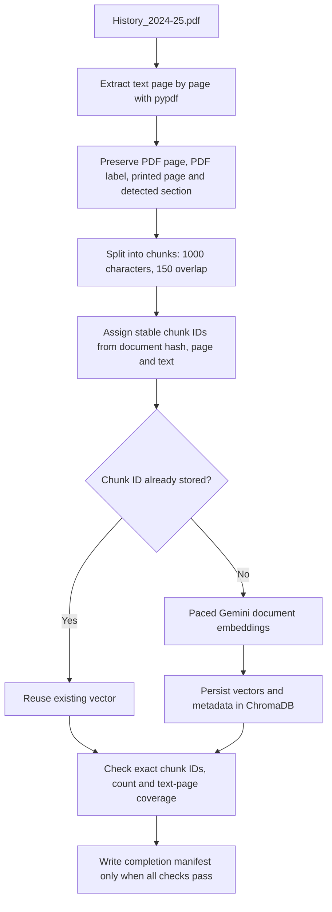
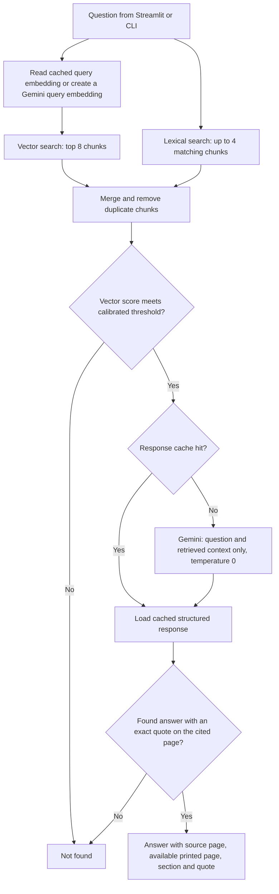
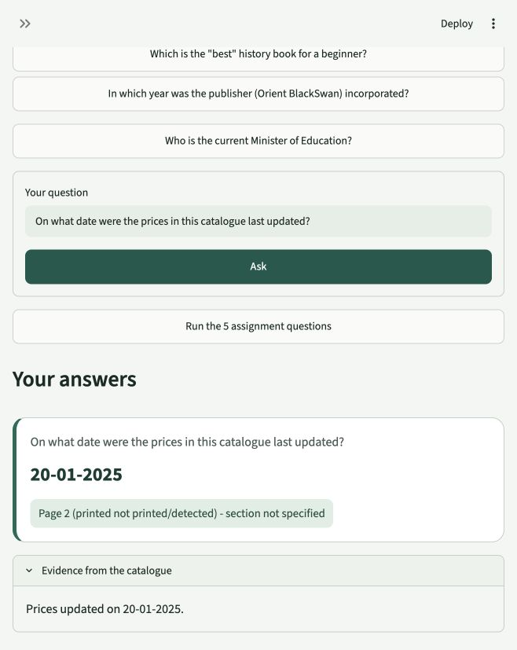

# Orient BlackSwan History Bot

A catalogue question-answering application built with **Python, LangChain, ChromaDB, Gemini, and Streamlit** for the GenAI mid-term project.

The bot searches the **Orient BlackSwan History catalogue 2024–25** and answers using retrieved passages. Supported answers include a PDF page reference and an exact evidence quote. When the catalogue does not provide a supported answer, the answer is exactly:

```text
Not found
```

## Project flow

### 1. Prepare and index the catalogue



The catalogue is processed page by page so chunks retain their source information. Stable IDs allow an interrupted ingestion to resume without embedding already stored chunks again. The collection records its embedding model and vector dimension to prevent incompatible vectors from being mixed.

### 2. Retrieve, answer and verify



Gemini receives the question, strict grounding instructions, and retrieved catalogue passages. Its response must follow this structure:

```json
{
  "found": true,
  "answer": "1948",
  "evidence_quote": "houses. Incorporated in 1948, the consistent emphasis of our publishing",
  "page": 2,
  "section": null
}
```

The application checks that the quote appears in a retrieved chunk after whitespace normalization and that the cited page belongs to that chunk. It uses stored page and section metadata for the displayed source. A failed verification produces `Not found`.

## Features

- Hybrid retrieval using vector similarity and lexical keyword matches.
- Source references and an evidence expander for supported answers.
- Five clickable assignment questions and a button to run all five.
- Session Q&A history, newest first, and optional retrieved-passage display.
- Persistent ChromaDB storage, resumable ingestion, and embedding model/dimension checks.
- Disk caches for query embeddings and Gemini generation responses.
- Generation call planning and a configurable `--max-calls` guard.
- Paced embedding requests, bounded retries, redacted logs, and explicit daily-quota stopping.

## Dataset and technology

| Component | Implementation |
|---|---|
| Runtime | Python 3.11 or 3.12; developed with Python 3.12.14 |
| PDF extraction | pypdf, with fonttools for embedded fonts |
| Chunking | LangChain `RecursiveCharacterTextSplitter` |
| Vector database | Persistent ChromaDB |
| Embeddings | Gemini `gemini-embedding-001`, 3,072 dimensions in the verified index |
| Answer generation | Gemini through `langchain-google-genai` |
| Verified generation model | `gemini-3.8-flash` |
| Interface | Streamlit |
| Tests | pytest |

The supplied catalogue contains **91 PDF pages**, including **90 pages with extractable text**, and produces **750 chunks**. Its first page is an image-only cover. These counts describe the supplied file, rather than every edition of the catalogue.

Model availability depends on the account and may change. Both model names are configured in `.env` and checked against the account's model list at startup. Listing a model does not guarantee a later generation request will succeed; live API errors are handled separately.

## Setup

Run commands from the repository root.

### 1. Create the environment

Use Python **3.11 or 3.12**. This example assumes `python3.12` is available on your PATH:

```bash
python3.12 -m venv .venv
source .venv/bin/activate
python -m pip install -r requirements.txt
python -m pip check
```

On Windows, activate the environment with `.venv\Scripts\activate` instead.

### 2. Add the catalogue locally

Place your copy of the assignment PDF at:

```text
data/History_2024-25.pdf
```

The PDF is intentionally excluded from Git. A clone does not include the PDF, generated vectors, caches, or local credentials. Obtain the catalogue separately before ingesting it.

### 3. Configure Gemini

```bash
cp .env.example .env
```

Edit `.env` locally. The following key is a placeholder, not a real credential:

```dotenv
GOOGLE_API_KEY=your_google_api_key
GEMINI_MODEL=gemini-3.8-flash
GEMINI_EMBED_MODEL=gemini-embedding-001
PDF_PATH=data/History_2024-25.pdf
EMBED_CHUNKS_PER_MIN=60
EMBED_TOKENS_PER_MIN=20000
```

Verify the configuration without displaying the key:

```bash
python scripts/check_env.py
```

If model names are missing or unavailable, the checker reports accessible generation and embedding model IDs. Choose supported IDs in `.env`. Changing the embedding model does not make it compatible with an existing collection; the application refuses incompatible reuse.

### 4. Inspect and ingest

```bash
python scripts/audit_pdf.py
python -m historybot.ingest
```

The audit prints extraction samples, page coverage, and chunk statistics. Ingestion checks model availability, embeds missing chunks, persists them in `chroma_db/`, and validates the final index. Run ingestion again to resume an interrupted run.

For a limited probe of missing chunks:

```bash
python -m historybot.ingest --max-new-chunks 20
```

The supplied retrieval calibration is documented in [RETRIEVAL_CALIBRATION.md](docs/RETRIEVAL_CALIBRATION.md). If you rebuild with different data or change retrieval behavior, recalibrate before evaluating:

```bash
python scripts/calibrate_retrieval.py
```

Calibration uses query embeddings but **zero generation calls**. It prints its query-embedding call plan before running and caches query vectors.

## Run the application

```bash
streamlit run app.py
```

Open **[http://127.0.0.1:8501](http://127.0.0.1:8501)**. The address is local to the computer running Streamlit; it is not a hosted demo URL.

Choose an example question, enter your own question, or select **Run the 5 assignment questions**. Supported answers show their page reference and evidence. The sidebar explains the flow, displays document/model details, and can reveal retrieved passages.

### Command-line usage

```bash
python -m historybot.cli "In which year was the publisher (Orient BlackSwan) incorporated?"
python scripts/run_questions.py
```

Example supported output:

```text
1948
Source: Page 2 (printed page not printed/detected), Section: not specified
Quote: Orient BlackSwan is one of India’s best known and most respected publishing
houses. Incorporated in 1948
```

For an unsupported question, the CLI's answer on standard output is exactly `Not found`. Call plans and optional diagnostics are separate from that answer; use `--debug` to inspect retrieval:

```bash
python -m historybot.cli "Who is the current Minister of Education?" --debug
```

## Assignment answers

These decisions were established through independent searches of the extracted PDF **before** implementing QA. Full matching pages and quoted lines are in [GROUND_TRUTH.md](docs/GROUND_TRUTH.md).

| # | Question | Verified answer | Source |
|---|---|---|---|
| 1 | On what date were the prices in this catalogue last updated? | **20-01-2025** | PDF page 2, price-update footer: “Prices updated on 20-01-2025.” |
| 2 | In which year was the publisher (Orient BlackSwan) incorporated? | **1948** | PDF page 2, publisher introduction: “houses. Incorporated in 1948, the consistent emphasis of our publishing” |
| 3 | What is the price of a Physics textbook? | **Not found** | No Physics textbook price is supplied. The nuclear-physics mention on PDF page 70 describes a history-of-science book. |
| 4 | Who is the current Minister of Education? | **Not found** | The catalogue does not identify the current education minister. |
| 5 | Which is the “best” history book for a beginner? | **Not found** | The catalogue does not explicitly establish this ranking. |

**Page numbering:** references use **1-based PDF pages**. PDF page 2 has embedded label `ii`, but no visible printed page number. The app keeps PDF labels and detected printed numbers separate. Missing printed numbers and section headings are reported as unspecified, rather than invented.

Verify these answers against your own copy of the PDF before submitting them.

## Screenshots

The following is a **real capture from the running local application**, showing the price-update answer, its page badge, and catalogue evidence:



To capture each question yourself, run `streamlit run app.py`, click the corresponding example, and include the question, answer, source, and expanded evidence in the capture. Save the five captures as `docs/screenshots/q1.png` through `q5.png`. Those five files have not been added yet; the README does not present placeholders as real captures.

These exact CLI commands also produce question-specific output for captures:

| Capture | Command |
|---|---|
| `q1.png` | `python -m historybot.cli "On what date were the prices in this catalogue last updated?"` |
| `q2.png` | `python -m historybot.cli "In which year was the publisher (Orient BlackSwan) incorporated?"` |
| `q3.png` | `python -m historybot.cli "What is the price of a Physics textbook?"` |
| `q4.png` | `python -m historybot.cli "Who is the current Minister of Education?"` |
| `q5.png` | `python -m historybot.cli 'Which is the "best" history book for a beginner?'` |

## Design decisions

**Why return `Not found`?** A relevant passage can still fail to answer the question. Abstaining prevents a related book description, an old political reference, or an unsupported recommendation from becoming an invented catalogue answer.

**Why hybrid retrieval?** Semantic search finds related passages, while lexical matching helps recover exact terms, dates, names, and catalogue details. The application merges and de-duplicates both result sets.

**Why verify evidence?** The system checks the quoted text and source page before displaying a supported answer. This reduces fabricated citations, although it does not prove that every possible interpretation of a real quote is correct.

**Why cache?** Query embeddings are cached by embedding model and question. Generation responses are cached by a hash of the generation model, system prompt, question, and retrieved context. Cached structured responses still pass through evidence verification.

**Why pace ingestion?** The first ingestion encountered a quota/rate-limit error. Conservative pacing allowed the remaining chunks to be indexed while retaining the 96 chunks already stored. The client budgets are safety settings, not a claim about the provider's exact quota.

## Call budgets and quota handling

```bash
python scripts/run_questions.py --max-calls 40
python scripts/run_questions.py --max-calls 0
```

`--max-calls` limits **generation attempts**, including retries. The runner prints the number of uncached generation calls it plans before generation starts. A zero-call run succeeds only when required responses are cached or the retrieval gate bypasses generation.

This guard does **not** disable model-list requests or uncached query-embedding requests. A new question can require an embedding even when generation is disabled. Caches stay local and are not included in a clone.

Embedding batches are paced by `EMBED_CHUNKS_PER_MIN` and `EMBED_TOKENS_PER_MIN`. Estimated tokens are **characters divided by four**, not provider-reported usage. Retry logic honors a returned delay, otherwise uses a 65-second fallback for 429s, with jitter and bounded backoff. An explicitly daily quota stops the run and reports the next midnight Pacific converted to IST, including daylight-saving changes. Existing vectors and caches are preserved.

Run only one ingestion process at a time. Redacted local diagnostics are written to `logs/embed.log` and `logs/generate.log`.

## Verification and results

| Check | Recorded result |
|---|---|
| Persisted index | **750/750 chunks**; exact chunk IDs match the splitter output |
| Text-page coverage | **90/90** pages with extractable text represented |
| Vector dimensions | **3,072** for every stored vector |
| Completed-ingestion repeat | **0 embedded, 750 skipped** |
| Offline unit tests | **20 passed** |
| Five assignment questions | **5/5 matched** independent ground truth |
| Cached five-question repeat | **5/5 matched**, **0 generation calls**, **4 cache hits**; one question bypassed generation |
| Retrieval-only calibration | **7/7** verified positive pages retrieved; **13/18** negative cases bypassed generation |
| Local interface | Opened in a real browser; supported and `Not found` result cards observed |

Run the checks:

```bash
python -m pytest -q
python -m pip check
python scripts/secret_scan.py
python scripts/run_questions.py --max-calls 40
```

The broader evaluation command is available, but its complete live QA accuracy has **not** been verified:

```bash
python scripts/run_questions.py --all --max-calls 40
```

Retrieval calibration used 25 questions: the five assignment questions, fifteen additional negatives, and five extra verified positives. Retrieval scores overlap between answerable and unanswerable questions. The threshold retains all seven positives; it does not claim perfect negative classification.

Evidence files:

- [Ground truth and keyword matches](docs/GROUND_TRUTH.md)
- [Retrieval calibration](docs/RETRIEVAL_CALIBRATION.md)
- [Five-question results](docs/ASSIGNMENT_RESULTS.json)
- [Ingestion verification](docs/PHASE_1_PACED_REPORT.md)

## Repository structure

```text
.
├── app.py                         # Streamlit interface
├── README.md
├── requirements.txt               # Exact installed dependency pins
├── pyproject.toml                 # Installable historybot package
├── .env.example                   # Configuration placeholders
├── .gitignore
├── .streamlit/config.toml         # Theme and local server settings
├── data/                          # Add the PDF locally; PDF is not committed
├── src/historybot/
│   ├── config.py                  # Configuration and model validation
│   ├── extraction.py              # Page-preserving extraction and chunk IDs
│   ├── embedding_runtime.py       # Pacing, logging and embedding retries
│   ├── ingest.py                  # Resumable indexing and completion checks
│   ├── retrieval.py               # Vector + lexical retrieval
│   ├── qa.py                      # Generation, cache and evidence verification
│   ├── cli.py                     # Command-line interface
│   └── questions.py               # Evaluation cases, not QA answer lookup
├── scripts/
│   ├── audit_pdf.py
│   ├── check_env.py
│   ├── calibrate_retrieval.py
│   ├── run_questions.py
│   └── secret_scan.py
├── tests/                         # Offline mocked/unit tests
├── docs/                          # Evidence, results and real screenshots
└── engine/                        # Original project-building toolkit
```

`chroma_db/`, `cache/`, and `logs/` are generated locally and excluded from Git.

## Security and GitHub upload

Never commit `.env` or an API key. `.env.example` contains placeholders only. The PDF is also kept local by design. The secret scanner checks working source files and tracked files, plus commits reachable from all Git refs and reflogs, and reports file/commit identifiers without displaying matching values.

Before uploading, stage your intended files, run the scanner, and inspect the staged filenames:

```bash
git add README.md app.py .streamlit src scripts tests docs requirements.txt pyproject.toml .env.example .gitignore
python scripts/secret_scan.py
git diff --cached --name-only
git status --short
```

Create a GitHub repository and use the repository URL GitHub gives you when configuring a remote. No repository URL is invented in this README. No push is required to run the app locally.

## Limitations

- OCR has not been run on the image-only cover. All other pages have extracted text.
- Multi-column extraction was sampled and compared with another extractor, not exhaustively checked for every book entry. Some rupee glyphs extract as backticks.
- Section detection is heuristic; unknown headings remain unspecified. Printed page numbers are stored only where detected.
- A verified quote/page does not guarantee that the model interpreted the quote correctly. The small calibration set is not proof of general accuracy.
- Full 25-case live QA accuracy, automated responsive viewport checks, and five separate assignment screenshots remain unfinished.
- The current dependency set was checked, and an earlier pre-Streamlit dependency set had a clean-environment installation check. A fresh installation of the final Streamlit-inclusive set has not been independently repeated.
- Gemini access, latency, quotas, and model availability depend on the account. Cached repeated questions need no new generation call, but the application still requires configured credentials and startup model access.
